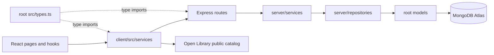
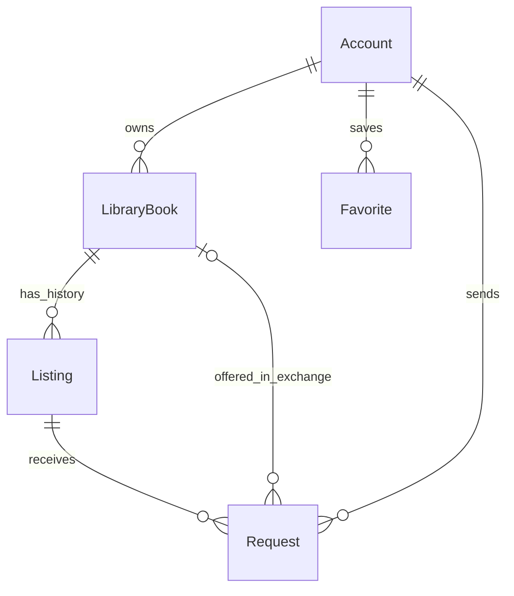

# TheBridge full-stack architecture

## 1. Review contract and inputs

This proposal gives frontend and backend contributors one implementation boundary for issue [#9](https://github.com/ninjasilver3692077/TheBridge/issues/9). **Juan and Jorge must approve it before the architecture/API contract is treated as agreed.** This branch contains documentation, not an Express implementation, a deployment, or a completed security audit.

**Review first:** [A-1–A-5 and Q-1–Q-3](#product-assumptions-and-questions-for-review) distinguish pending architecture decisions from product requirements now confirmed by the PRD author. Q-1 blocks Reserved-listing moderation until the PRD owner defines safe settlement; it does not block the Express skeleton. The architecture and API proposal can be reviewed independently of provisioning hosting resources.

Inputs reconciled on 2026-10-28:

- Existing application and policies at `main` commit `dc7bd2c`.
- [PRD](https://github.com/ninjasilver3692077/TheBridge/blob/e8545a29e7a4502a282f06f21c044de1e0b5cd79/_bmad-output/planning-artifacts/prd.md), FR-1–FR-28 and NFR-1–NFR-19, from PR #13. It is marked final and ready for review, but remains unmerged and has no recorded human approval. Its introduction records Juan's confirmation of the former drafting assumptions; this does not approve the architecture.
- [Product brief](https://github.com/ninjasilver3692077/TheBridge/blob/e8545a29e7a4502a282f06f21c044de1e0b5cd79/_bmad-output/planning-artifacts/product-brief.md) and [rubric addendum](https://github.com/ninjasilver3692077/TheBridge/blob/e8545a29e7a4502a282f06f21c044de1e0b5cd79/_bmad-output/planning-artifacts/briefs/brief-TheBridge-2026-10-26/addendum.md).
- Original HW11–HW15 README/rubric files in the supplied course ZIP; current storage, catalog, validation, filters, routing and login modules.

The canonical HTTP contract is root [`api-design.md`](../../api-design.md). This document owns boundaries, persistence, deployment and migration. The [architecture spine](architecture/architecture-TheBridge-2026-10-27/ARCHITECTURE-SPINE.md) records cross-team invariants. Do not independently maintain a second endpoint table in architecture, OpenSpec, or client code: changes cite the same operation IDs and update the contract in an approved PR first.

The PRD update fixes collection pagination at 10 by default and explicitly locks Pending offered copies; the contract follows both. A-4/A-5 now record confirmed product requirements, while A-1–A-3 remain proposed interpretations. FR-24 now defines rejection of Accepted requests on removal, but physical return and repeated removal against a reused copy still need clarification. Original 2026-10-27 review reports remain evidence for their original input; this reconciliation does not turn them into approval of the updated PRD.

## 2. Decisions and alternatives

| Decision | Proposed choice | Alternative considered and reason not selected |
| --- | --- | --- |
| Application boundary | Layered modular monolith: React client and Express API | Microservices add distributed ownership and deployment work without a course requirement. |
| Persistence | MongoDB Atlas through Mongoose | SQLite in the teaching demo is illustrative; HW12 explicitly requires MongoDB/Mongoose. |
| HTTP source | Root `api-design.md`, linked by this document | Mirrored HTTP tables drift and obscure which response shape implementers must follow. |
| Graded paths | Real root `routes/`, `models/`, `src/types.ts`, owned by the server/shared boundary | Symlinks are fragile on Windows; duplicate implementations and empty grading facades are not acceptable. |
| Deployment | One Vercel project/origin for static client and one Express function | Separate public origins require more CORS/environment coordination and do not satisfy the PRD's single-URL target as directly. |
| Authentication | JWT bearer token; registration always creates Member | The local boolean is only a Milestone 2 simulation. Cookie-only auth would depart from the supplied HW13 token-storage requirement. |

All choices in this table are review proposals except course-mandated technology. No source folders are moved by this issue.

## 3. Boundaries and repository layout



Pages/hooks never fetch or access domain localStorage directly. Services translate DTOs into the existing view models, normalize failures, carry bearer tokens, cancel searches and refresh affected state. Theme remains a device preference; catalog cache remains public metadata. Auth storage is encapsulated in `client/src/services/authStorage`; it is cleared on logout/expiry and never contains passwords.

Root `routes/` and `models/` are part of the server, not separate applications. Route modules import server services; services use repositories; repositories use models. Models and repositories never import routes or React. HTTP DTOs contain no Mongoose document types. The only module both runtimes import is the shared types module, using type-only imports.

Target seed layout, created by later approved stories:

```text
TheBridge/
  package.json                 root scripts and dependency lock
  client/
    index.html
    vite.config.js
    public/assets/
    src/{pages,components,hooks,services,styles,data}/
  server/
    app.js                     Express composition; no production listener
    dev.js                     local listener on PORT
    config/
    middleware/
    services/
    repositories/
    scripts/                   bootstrap-admin and explicitly invoked seed
  routes/                      real Express routers, initially .js, then .ts
  models/                      real Mongoose schemas, never duplicate copies
  src/types.ts                 shared DTO interfaces and discriminated unions
  api/index.js                 thin Vercel export of server/app; later .ts
  api-design.md
  tsconfig.json
  .env.example
  deployment.txt
  security-audit.md
  vercel.json
```

Keep one root package/lock initially: scripts explicitly target `client/` and `server/`, so no workspace package setup is needed. Root `npm run dev` runs Vite and the local listener; `npm run build` builds `client/dist`; root lint covers client/server/routes/models. Add `typecheck` in HW14. Existing `src/` becomes `client/src/` during the dedicated split story; the future root `src/types.ts` is the shared boundary. Do not leave two runtime frontend trees.

### Grading and shared-type resolution

Root `routes/`, `models/`, `api-design.md`, `deployment.txt`, `.env.example`, `tsconfig.json`, `security-audit.md` and `src/types.ts` match the literal paths in the original rubric. Root route files contain typed Express handlers by HW14; they are not re-export-only wrappers. Root `src/types.ts` defines at least Account, LibraryBook, Listing, Request and response types; client/server import that exact module.

The HW14 root compiler includes migrated client components, server modules, root routes/models and shared types with `strict: true`, `noEmit: true`, `allowJs: true`, `checkJs: false` during incremental migration. No explicit `any` is permitted in any authored TS/TSX file; route Request/Response bodies, params, queries and envelopes use concrete generics from the shared types. Require both `tsc --noEmit` and a no-explicit-any lint check; passing compilation alone does not prove the no-any rule. `@/types` resolves only to root `src/types.ts` in TypeScript and the Vite type-check configuration; backend imports must be `import type` because Vercel does not implement TypeScript runtime path mappings. Runtime server imports use relative paths. Migrate at least three React components and two real root route files; broad migration is not a prerequisite to HW11.

The supplied evaluator's `sourcePaths` sometimes contain directories but its reader does not traverse those entries. Matching paths alone cannot repair that evaluator. The coordinator must confirm the grading root/source collection with the instructor before the weekly submission; do not rewrite grading tools or claim an autograder pass here.

## 4. Data ownership and consistency



| Entity | Stored fields and constraints |
| --- | --- |
| Account | `name`, normalized unique `email`, `passwordHash` excluded by default, fixed `role: Member/Admin`, timestamps. No account-edit, role-change or account-delete API. |
| LibraryBook | `ownerId` Account reference, catalog metadata snapshot, `condition`, `notes`, status, version, timestamps. Physical identity belongs here; two copies of the same work have different IDs. |
| Listing | `libraryBookId` and `ownerId` references, publication-time book/condition/notes snapshots, modality/terms, status, public version, internal revision, timestamps; removal reason and actor retained on moderation. Owner/name is populated explicitly, never the entire Account. |
| Request | `listingId`, `ownerId`, `requesterId`, optional `offeredBookId`, status, immutable quoted modality/terms and offered-copy summary, listing version, version, timestamps. Participant IDs come from authenticated resources, never the body. |
| Favorite | `ownerId` reference and catalog metadata snapshot; unique `(ownerId, catalogId)`. Favorites persist between devices. |

MongoDB generates `_id` values; DTOs expose `id` as an opaque 24-hex string and suppress `_id`, `__v`, password hashes and internal search fields. UTC timestamps use ISO 8601; COP prices are positive integer pesos, never formatted currency strings; allowed durations are 7, 10, 14 or 21 days. DTO fields, nullability and payloads are fixed in `api-design.md`.

Catalog metadata uses `catalogId` such as `/works/OL45804W`; it is not a database ID. Preserve title/author/cover/year/publisher/ISBN/language and genre independently of Open Library availability. Public DTOs expose owner name but not email. Admin-only DTOs may expose member emails for FR-23.

LibraryBook statuses are Available, Published, Reserved, Lent, Transferred. Listing statuses are Available, Reserved, Closed, Removed. Request statuses are Pending, Accepted, Rejected, Cancelled, Completed. Translate legacy `Loaned` to `Lent` in the migration/seed adapter, not in shared enums.

### Mutation authority

Only server domain services mutate state. A client cannot set owner, role, listing/request status, removal actor, totals, activity or versions. `version` is a monotonically increasing integer for public representation changes; mutation preconditions are defined in the API contract. An internal `revision` is a separate write barrier, never serialized and never treated as the quoted terms version.

Use Mongoose transactions on an Atlas deployment that supports them for multi-document writes. Every database operation in a transaction uses the same session and runs sequentially. On conflicting conditional writes, retry only transient transaction failures; after retry, re-read and return a domain conflict when the precondition no longer holds. Do not use a process variable or mutex as a reservation lock.

Required unique indexes:

- Account normalized email.
- Favorite `(ownerId, catalogId)`.
- Listing `libraryBookId` where status is Available or Reserved: one open listing per copy.
- Request `(listingId, requesterId)` where status is Pending or Accepted: one active request per member/listing.
- Request `listingId` where status is Accepted: at most one winner.
- Request `offeredBookId` where it is an ObjectId and status is Pending or Accepted: one active exchange offer per offered copy, following the confirmed product requirement in A-4.

Create and verify these indexes in an explicit migration/bootstrap step; `unique` is not a Mongoose validator. Map duplicate-key errors to 409. **Every Pending request creation and every edit/accept/withdraw/remove/complete command conditionally writes the same Listing internal revision in its transaction.** Reads alone are insufficient: after a race, a retried insertion must re-read status/quote and cannot create Pending after reservation or closure. Merely inserting a Pending request increments internal revision but does not change the public Listing version, so other Pending quotes remain current. Terms edits increment public version; acceptance compares the request's quoted version against that public version before changing state.

State checks and conditional revision/version increments also touch the relevant LibraryBook even if its visible status remains Available, so concurrent offer creation and publication contend on the same document rather than passing independent reads. Transaction retries use fresh snapshots; public If-Match still detects user-visible stale updates.

### State transition effects

| Command | Preconditions | Atomic effects |
| --- | --- | --- |
| Publish | Member owns Available copy; no active outgoing exchange offer; no open listing | Create Available listing; set copy Published. |
| Edit listing | Owner; listing Available; matching version | Replace modality/terms; increment version; Pending requests remain Pending with their original quote. A-3 governs subsequent acceptance. |
| Withdraw | Owner; listing Available; matching version | Soft-close listing with `closureReason: Withdrawn`; return copy Available; reject all Pending requests. Preserve history. |
| Send request | Member is not owner; listing Available; current quoted version | Create Pending request; validate an owned Available offered copy for Exchange; reject duplicates and occupied offers. |
| Accept | Owner; request Pending; listing Available; quote/version still current | Set winner Accepted and listing Reserved; reject competing Pending requests. Loan/Rental copy becomes Lent; Sale/Exchange copy Reserved; Exchange offered copy Reserved. |
| Reject | Owner; request Pending | Set Rejected; release derived Pending exchange activity. |
| Cancel | Requester; request Pending | Set Cancelled; release derived Pending exchange activity. |
| Complete | Owner; request Accepted; listing Reserved | Close listing and set request Completed. Loan/Rental copy returns Available (A-1); Sale/Exchange copies become Transferred, with no automatic transfer into the other library. |
| Remove Available listing | Admin; nonempty reason; matching version | Set Removed; preserve reason/actor; return copy Available; reject Pending requests. |
| Remove Reserved listing | Admin | Product conflict Q-1 must be resolved before implementing this branch. Do not release a Lent/Reserved copy or orphan an Accepted request. |

All losers of a concurrent accept/withdraw/remove operation receive 409 without partial changes. Creation/acceptance revalidate offered-copy eligibility and the current quote while the listing is Available. Completion instead requires the accepted participants' reserved/lent state; it must not compare the old quoted version against the incremented post-acceptance listing version. Request history remains readable to its participants after a listing is Closed or Removed, even though a Removed listing's public detail is 404.

## 5. Authentication, Admin bootstrap and security

### Sessions and client lifecycle

JWTs carry `sub`, `role`, `iss`, `aud`, `iat`, `exp`, signed with an allowlisted HS256 algorithm and a strong server secret. Proposed issuer/audience are `thebridge-api`/`thebridge-client`. Twenty-four-hour expiry follows FR-4, now confirmed by the PRD author (A-5). Middleware verifies signature/claims, loads the Account and checks the stored role before authorizing an operation. Decode-only client checks never authorize server actions.

Use bcryptjs asynchronous hashing with a proposed cost of 12; reject passwords below eight characters or above 72 UTF-8 bytes rather than silently truncating. Normalize email consistently before lookup/indexing. Login returns one generic wrong-credentials message. Registration rejects privileged fields such as `role` or `passwordHash` with 400.

Client logout clears the token and account cache. Every login/logout/expiry increments a session-generation value; each private service request captures that generation/account and discards both results and failures if the generation no longer matches. Abort old requests where possible; clearing a store alone does not prevent a late response for account A from populating account B's screen. Stateless JWTs already issued remain cryptographically valid until expiry; immediate global revocation is not claimed. One app-shell/session observer checks expiry on startup, on tab visibility/focus, before protected actions and with a timer while any page remains mounted, including public pages; it handles current-session server 401 centrally and clears cached private data. An expired active session redirects to login with the FR-4 message and a validated same-origin relative return route. Never redirect to an arbitrary URL.

### Admin bootstrap

A later `server/scripts/bootstrap-admin` command reads `MONGODB_URI`, `ADMIN_NAME`, `ADMIN_EMAIL`, `ADMIN_PASSWORD` from one-off operator environment variables. It validates and hashes with the same account service, creates one Admin idempotently under the unique email index, and exits without changing an existing Member or resetting any password. A role collision is an explicit error. Run it manually against the intended Atlas environment, never at request time or on every deploy. Remove the one-off password from the shell/secret store after use. No public promotion route, default password or automatic user promotion exists.

### Request pipeline and deployment-wide controls

Express middleware order: request correlation/log redaction, CORS/origin policy, Helmet, JSON parser with a 32 KiB limit, auth rate limiting, routes with authentication/authorization/validation, API 404, centralized error middleware. Reformat malformed JSON, oversize bodies, rate-limit responses, Mongoose validation/cast errors and unexpected errors into the canonical two-field JSON envelope. Never return stack traces or database messages.

CORS allowlists exact client origins per environment and sends no wildcard. Reject unapproved browser Origin values before a write; allow requests without Origin for authenticated non-browser clients and grading tools. CORS is not authentication. Do not pass body objects, query operators, raw regexes or arbitrary sort keys to Mongoose. React renders user text as text, never HTML. Allow only HTTPS Open Library cover URLs in stored catalog metadata; the backend does not fetch a user-supplied URL.

Use Helmet and express-rate-limit on login/register. An in-memory rate-limit store is a local-development convenience only; the Vercel deployment must use a shared persistent limiter store or a deployment-wide Vercel rule. Proposed thresholds are 10 login attempts and 5 registrations per 15 minutes per correctly resolved client IP; verify proxy trust on the actual deployment. The chosen limiter backend is a deployment gate, not a claim of existing production protection.

## 6. Local runtime, environment and deployment

| Setting | Proposed value / responsibility |
| --- | --- |
| Node | Node 24 LTS; verified authoring release 24.22.1; Vercel manages its supported 24.x patch. Local current runtime was 24.19.0; no runtime upgrade performed here. |
| Local API | `http://localhost:3000`, configurable `PORT`; one listener only in `server/dev`. |
| Local client | `http://localhost:5173`; Vite proxies `/api` to the API with no prefix stripping. Client services use relative `/api` URLs. |
| Final origin | One coordinator-owned Vercel origin, with client at `/` and API at `/api`. |
| Static output | `client/dist`; public assets come from `client/public` and `import.meta.env.BASE_URL`. |
| Database | Separate Atlas development/test and production databases; warm-instance connection promise reuse, no per-request disconnect and no process-memory domain source of truth. |
| Secrets | Server-only environment; none prefixed `VITE_`. Preview never falls back to production credentials. |

Vercel project Root Directory remains the repository root so it can build the client and trace server/root route/model imports. `api/index` exports the Express app without listening. Configure API rewrites to the shared function **before** the SPA fallback; the function receives the full original `/api/...` pathname and query. Static asset resolution precedes the browser fallback. An `/api` miss must return JSON 404, never `index.html`; a browser deep link serves the SPA and lets React show its route/404 screen. The dedicated deployment story must verify these routing rules with actual preview requests before documenting an exact working configuration or URL.

The hosting story changes Vite `base` from `/TheBridge/` to `/`, updates the coordinator-owned README and AGENTS deployment policy, and replaces the gh-pages deployment command under a separately approved change. Until then, the existing GitHub Pages build/deployment is preserved. This architecture branch does not authorize an agent to deploy.

Future `.env.example` variables:

| Name | Meaning |
| --- | --- |
| `NODE_ENV`, `PORT` | Runtime mode and local listener port. |
| `MONGODB_URI` | Atlas URI scoped to the environment; required after HW11. |
| `JWT_SECRET`, `JWT_ISSUER`, `JWT_AUDIENCE`, `JWT_TTL_SECONDS` | Server token policy; proposed TTL 86400. |
| `CLIENT_ORIGINS` | Exact comma-separated allowed browser origins; development includes localhost:5173. |
| `RATE_LIMIT_STORE_URI` | Deployment-wide limiter storage; required if the shared-store approach is selected. |
| `ADMIN_NAME`, `ADMIN_EMAIL`, `ADMIN_PASSWORD` | Bootstrap command inputs only, not client/runtime defaults. |

No secret or invented Vercel URL is added in this issue. `deployment.txt` is created/updated only after a real deployment is verified. Startup fails clearly for missing required configuration; public health exposes only readiness state, not secrets. Database unavailability returns sanitized 503; unexpected faults return sanitized 500. Private responses and bearer-authenticated collections use `Cache-Control: no-store`.

Operational minimum: structured logs with request ID, method, route, status and latency; never log bearer tokens, passwords, raw bodies or MongoDB URIs. Choose the function region near Atlas during deployment; verify cold/warm database connections, error routing and persistence across instances. No background job, websocket, scheduled expiry or realtime infrastructure is required for this PRD.

## 7. Staged implementation and compatibility

| Stage | Deliverable and guard |
| --- | --- |
| HW11 | Document-first listing CRUD with interchangeable in-memory listing/copy repositories, pagination and consistent errors. A server-controlled demo owner and two Available copy fixtures (IDs specified in api-design.md) make POST testable before COPY-03 exists. No submitted owner/role fields. The disposable public demo contains no private accounts and makes no durability/security claim. |
| HW12 | Introduce real related schemas/repositories, validation and explicit index bootstrap; populate a safe owner projection in listing responses. An explicitly invoked seed creates the real demo Member/copies in the isolated grading database; the temporary server-owned demo identity targets that persisted Member until HW13 auth. In-memory fixture fallback is removed. |
| HW13 | Real register/login, member/admin guards, requests/favorites/moderation, client service migration and account-scoped data. Remove runtime domain mocks and automatic library seed. New accounts start empty. |
| HW14 | Shared root types; three typed React components and two typed route files minimum; strict no-emit type check. |
| HW15 | Evidence-based security audit, shared rate limiter, headers/validation checks and verified final Vercel URL. |

Every weekly submission also requires a verified public Vercel URL returning 200 in `deployment.txt`, successful lint, endpoint/manual evidence and that week's required answers in `AI-LOG.md`. HW11 may deploy an API-only root health/intro response; by HW13–HW15 the one public origin must serve the working integrated client and API. Actual weekly URLs and results belong to implementation/deployment PRs, not this proposal.

Backend services expose repository interfaces before storage changes, but final reads and mutations use Atlas. The HW11 and final contracts use the same response envelopes; final auth requirements in `api-design.md` are activated at HW13. Do not ship a selectable unauthenticated demo mode in the final production app.

For HW12, the one-off grading seed takes its demo Member credentials from operator environment variables, hashes them through the same account model/service and retains referentially valid copy IDs; it never runs automatically or promotes an account. The HW13 auth story removes the temporary fixed-identity adapter entirely and exercises real Member/Admin tokens. These weekly demo arrangements do not authorize access to real private accounts before auth exists.

Client migration map:

| Current service/behavior | Future boundary |
| --- | --- |
| `listingsStorage` and listing filters | Listing API adapter; server-side search/pagination/statistics; preserve cards and quick view. |
| `myBooksStorage`, `librarySeed` | Own-library API adapter; server-derived activity; no automatic production seed. |
| `requestsStorage` | Request API adapter; server owns participant identity and atomic transitions. |
| Direct auth access in App/Login/useMarketplace | `authStorage` and auth API adapter; account-scoped favorites service. |
| `openLibrary` and cache | Public catalog service with abort/retry/saved-data behavior; ensure Add Book and desired-book search expose saved-data timestamps too. |
| `src/data/navigation`, About text | Static UI configuration remains legitimate; not simulated domain data. |

The internal service call sites may become asynchronous and acquire loading/error states; retaining the service boundary does not mean promising zero component changes. DTO adapters preserve visible book fields while translating `coverUrl`, `durationDays`, IDs and statuses.

Do not import localStorage data silently into accounts. Any optional personal-data import is a separately approved feature. Demo seeds are explicit server commands, idempotent and referentially valid; no production startup seeding. The coordinator/team chooses demo content (PRD Q4).

## 8. Traceability and implementation gates

| Requirements | Architecture / contract coverage |
| --- | --- |
| FR-1–FR-4 | Account model, auth middleware, authStorage, AUTH operations; expiry/return route. |
| FR-5–FR-6 | Public Open Library service/cache and FAVORITE operations; three-character minimum shared by all catalog entry points. |
| FR-7–FR-9 | COPY operations, account ownership, activity, Available-only mutations. |
| FR-10–FR-12 | LISTING write operations, one-open-listing index, transaction boundary. |
| FR-13–FR-16 | LISTING public reads/stats; summary and newest listings derived from the same available dataset. |
| FR-17–FR-21 | REQUEST operations, quote/version checks, atomic state machine. |
| FR-22–FR-24 | ADMIN operations, restricted projections, reason retention; Q-1 before Reserved moderation. |
| FR-25–FR-28 | Role-aware navigation, auth return routes, existing theme/About and browser fallback. |
| NFR-1–NFR-7 | Single origin, lint, HTTP envelope/validation/status/pagination, root design file before code. |
| NFR-8–NFR-14 | Hashing, JWT, origin allowlist, typed validation, safe text, environment secrets, Helmet and deployment-wide rate limiting. |
| NFR-15–NFR-19 | Shared types, service boundaries, no code comments, English UI, responsive/accessibility and async feedback. |

Before the Express skeleton: Juan/Jorge approve layout, API source, runtime, graded-path strategy and bootstrap approach; PRD FR IDs are available in PR #13, which is ready for review but not approved. Before each domain implementation: approve its OpenSpec change against this contract and resolve the relevant product gates below. Do not mark issue #9 complete until both required human reviews are recorded.

### Product assumptions and questions for review

| ID | Proposal / unresolved point | Approval or revisit condition |
| --- | --- | --- |
| A-1 | Completing Loan/Rental records physical return, not initial pickup; otherwise FR-21 would make an absent copy Available. | Juan confirms wording with PRD before completion story. |
| A-2 | Owner withdrawal closes with reason Withdrawn instead of physical deletion, preserving participants' request history. | Juan/Jorge approve contract semantics for FR-12. |
| A-3 | Pending requests keep quoted terms; after listing edit, acceptance conflicts until requester cancels/resubmits on the new version. | Juan confirms this safety interpretation of FR-11 before editing/acceptance stories; preserving Pending alone does not define consent to changed terms. |
| A-4 | One Pending/Accepted exchange offer per offered copy; copy mutations are blocked by that activity, matching the existing client behavior. | Pending exclusivity/mutation blocking is explicit in FR-9 at e8545a2; Accepted reservation follows FR-19. Product requirement confirmed; technical enforcement still needs Juan/Jorge architecture approval. |
| A-5 | Eight-character minimum, 24-hour session, account-only server favorites, cancellation and no automatic ownership transfer follow FR-1/FR-4/FR-6/FR-20/FR-21. | The PRD introduction records Juan's confirmation at e8545a2. These are product requirements, not pending drafting assumptions; PR #13 and this architecture still require review. |
| Q-1 | FR-24 now explicitly rejects Pending/Accepted requests and releases their copies, including Lent books. Rejection does not establish physical return; repeating removal of an old Removed listing must not release a copy used by a newer listing. | Juan must clarify safe copy availability before that branch is implemented; API currently specifies 409 for Reserved/Removed removal as an explicit proposed exception, not full FR-24 compliance. |
| Q-2 | Shared limiter backend, Vercel project/account/region and actual origins/URLs are not provisioned here. | Coordinator resolves in deployment/security stories and supplies real verification evidence. |
| Q-3 | Instructor's evaluator root and directory-source handling need confirmation. | Coordinator confirms before weekly submission; root actual modules avoid the known path mismatch. |

Questions Q-1–Q-3 do not prevent writing the Express skeleton. They are explicit gates on the affected downstream stories. This proposal is reviewable without claiming that those product/deployment decisions are already agreed.

## 9. Acceptance evidence to require downstream

Use real request/response tests for valid CRUD, pagination/filter totals, invalid bodies/IDs, unauthenticated 401, wrong-role 403, foreign private resources 404 and state/version conflict 409. Test duplicate registration, role injection, password omission from all projections and expired JWT redirects. Delay an account-A response until after B logs in and assert neither its data nor its 401 changes B's session. Race two accepts, accept-vs-withdraw and new-Pending-vs-accept/withdraw/remove; assert exactly one winner, no late Pending on a terminal listing and consistent copies/requests after rollback. Include exchange copy contention and publication-vs-offer creation.

For public deployment, verify root 200, `/api/health`, JSON API 404, direct React deep links, private no-store responses, malformed/oversized JSON envelopes, unknown methods, allowed/disallowed Origin behavior, persistent data after cold starts, shared auth rate limiting and Admin bootstrap rerun behavior. Verify all four modalities and both roles with two Members and one Admin. A written plan or passing frontend build is not evidence that any of these backend checks already pass.

## 10. Research and version seed

Versions checked through each package's npm registry metadata on 2026-10-27: Express 5.3.0; Mongoose 9.11.4 (Node >=20.19); jsonwebtoken 9.0.3; bcryptjs 3.0.3; TypeScript 7.0.2; helmet 8.3.0; express-rate-limit 8.7.1; cors 2.8.6; dotenv 18.0.9. These are proposed installation seeds, not dependency upgrades performed here. Preserve lockfile-resolved React/React DOM 19.3.0, React Router 6.30.6 and Vite 8.3.1 until their dedicated compatibility/security change; package.json's React range starts at 19.2.8 but is not the resolved version. Recheck patch advisories before adding server dependencies.

Primary sources checked for the implementation choices:

- [Node releases](https://github.com/nodejs/node/releases) and [Vercel Node runtime](https://vercel.com/docs/functions/runtimes/node-js): runtime and shared-function boundaries.
- [Vercel Express](https://vercel.com/docs/frameworks/backend/express), [Vite](https://vercel.com/docs/frameworks/frontend/vite) and [rewrites](https://vercel.com/docs/routing/rewrites): proposed single-origin composition; deployed routing still requires the tests above.
- [Mongoose transactions](https://mongoosejs.com/docs/transactions.html) and [MongoDB partial indexes](https://www.mongodb.com/docs/manual/core/index-partial/): transactional/uniqueness design.
- [jsonwebtoken](https://github.com/auth0/node-jsonwebtoken) and [bcryptjs](https://github.com/dcodeIO/bcrypt.js): token verification and password-byte limit.
- Package metadata: `https://registry.npmjs.org/<package>/latest`; exact checked versions recorded above, not an instruction to install an unpinned latest release.
