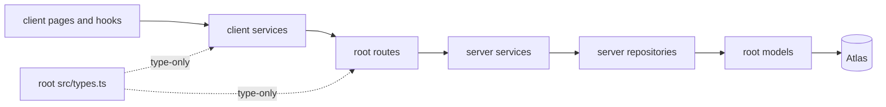
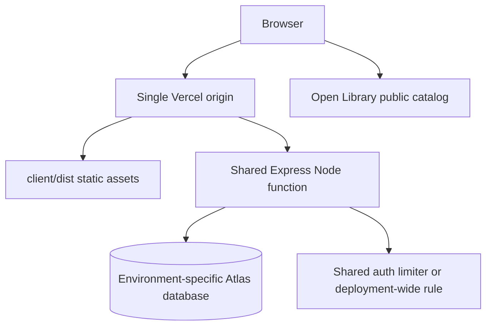

# Architecture Spine — TheBridge

## Design Paradigm

Layered modular monolith. React owns presentation; client services own HTTP/catalog/auth-storage adapters; Express routes own transport; server services own authorization and state transitions; repositories/models own persistence. This is a review proposal, not a claim of human approval or an implemented server.

## Invariants and Rules

### AD-1 — Preserve the client service boundary [ADOPTED]

- **Binds:** all client capabilities; NFR-16.
- **Prevents:** components inventing HTTP/storage access and incompatible data sources.
- **Rule:** pages/hooks depend on client services only; only authStorage handles the token, public catalog service handles its cache, and theme remains the explicit device-preference exception. Services translate wire DTOs into view models.

### AD-2 — One transport contract and shared DTO owner

- **Binds:** all API operations and NFR-3–NFR-7/NFR-15.
- **Prevents:** parallel frontend/backend implementations choosing incompatible fields and errors.
- **Rule:** root api-design.md is canonical for operation IDs, fields/nullability, enums, preconditions, errors and pagination (default 10, per FR-13/NFR-6). Root src/types.ts is the sole shared DTO module; serializers strip persistence/internal/private fields. Approved contract changes precede code.

### AD-3 — Real graded modules without duplicate implementations

- **Binds:** HW11–HW14; all backend contributors.
- **Prevents:** working client/server builds that omit required root paths or maintain divergent copies.
- **Rule:** client/ owns UI; server/ owns composition/domain/repositories; root routes/ and models/ are actual server modules; root src/types.ts owns shared types. No fake placeholders, symlinks or runtime frontend duplicate. Runtime imports are relative; @/types is type-only.

### AD-4 — Separate physical identity from catalog metadata [ADOPTED]

- **Binds:** FR-5–FR-21.
- **Prevents:** shared Open Library IDs becoming ownership/reservation keys.
- **Rule:** LibraryBook has a unique database ID and owner; Listing/Request reference copies and accounts. catalogId is external metadata only. IDs serialize as strings, timestamps as UTC ISO 8601, prices as integer COP and durations as enumerated day counts.

### AD-5 — Server authority over identity and roles

- **Binds:** FR-1–FR-4, FR-17–FR-25; NFR-8–NFR-14.
- **Prevents:** browser flags, submitted owner fields or decoded-only JWTs granting privileges.
- **Rule:** verify JWT signature/issuer/audience/expiry, load Account and enforce stored role/ownership on every protected operation. Registration creates Member only; Admin uses an explicit idempotent offline bootstrap. Public projections omit email; hashes are never returned. Session changes invalidate in-flight private results/failures by a generation/account guard, not just by clearing stores.

### AD-6 — Atomic publication and request transitions

- **Binds:** FR-9–FR-12, FR-17–FR-24.
- **Prevents:** double acceptance, partially released copies and process-local locking failures.
- **Rule:** domain services execute guarded version/status writes with one Atlas transaction/session, sequentially. Pending creation and all Listing lifecycle commands conditionally write a common internal Listing revision; it is distinct from public/quoted version, so inserting Pending does not stale existing quotes. Required active-state unique indexes enforce open listing, active member request, accepted winner and offered-copy exclusivity. Race losers receive 409 and no partial effects. Offered-copy guards must contend on the copy document, not only read it.

### AD-7 — Preserve quotes, history and participant access

- **Binds:** FR-11–FR-12, FR-18–FR-21; assumptions A-1–A-3 and confirmed product requirement A-4.
- **Prevents:** silently accepting edited terms, deleting request history or promising unavailable books.
- **Rule:** listings retain publication-time book/condition/notes snapshots. Requests retain request-time metadata, quoted modality/terms/version and offered-copy summaries; offered nullability follows quotedModality, never a later listing edit. A stale quote blocks acceptance with 409 until resubmission. Withdrawal is soft closure; participant summaries survive and report current retained listing status. Completion timing remains an explicit approval assumption. Offered-copy exclusivity follows FR-9/FR-19; Reserved moderation is gated by Q-1 and cannot silently release a Lent copy.

### AD-8 — One origin, distinct API and browser routing

- **Binds:** FR-13/FR-28; NFR-1/NFR-10.
- **Prevents:** deep-link fixes swallowing API errors and incompatible environment base paths.
- **Rule:** final Vercel root serves the static client and /api through one shared Express function; API routing precedes SPA fallback and retains original path/query. Local Vite 5173 proxies /api to Express 3000. GitHub Pages base changes only in an approved hosting story. Validate deployed API JSON errors and browser deep links before accepting hosting.

### AD-9 — Persistence and security survive multiple instances

- **Binds:** FR-6–FR-24; NFR-8–NFR-14.
- **Prevents:** serverless cold starts losing domain data or bypassing auth limits.
- **Rule:** Atlas is authoritative after HW12; cache the connection promise, not domain state. Production auth limits use a shared store or deployment-wide rule. Exact origin allowlist, server validation, sanitized JSON errors and redacted logs apply to every request. No private response caching or client-visible secrets.

### AD-10 — Preserve course sequencing and review gates [ADOPTED]

- **Binds:** all weekly deliveries and all contributors.
- **Prevents:** an architecture draft being interpreted as authorization to implement/deploy or as proof of completed grading.
- **Rule:** issue 9 ends with Juan/Jorge review; downstream code needs an approved OpenSpec change. HW11 uses a disposable in-memory owner fixture only; HW13 has no production demo fallback. Remaining architecture assumptions and Q gates stay explicit. Agents commit locally; people publish/merge under AGENTS.md.

## Consistency Conventions

| Concern | Convention |
| --- | --- |
| Response/error | data envelope; paginated meta; exactly error string/code status on failures. |
| Versions | integer version plus strong If-Match on existing-resource writes; 409 on stale state. |
| Status authority | Only server services update states; Request direction/activity are derived. |
| Search and totals | Same authorized available-only filter for listing rows/stats; pagination never changes totals. Filter-option facets span all Available listings independently of page/filters. |
| Shared types | At least Account, LibraryBook, Listing, Request plus envelopes; no Mongoose types on the wire. |

## Stack

| Name | Version |
| --- | --- |
| Node.js | 24.22.1 authoring target; managed 24.x on Vercel |
| React and React DOM | 19.3.0 existing lockfile |
| React Router | 6.30.6 existing lockfile |
| Vite | 8.3.1 existing lockfile |
| Express | 5.3.0 proposed seed |
| Mongoose | 9.11.4 proposed seed |
| jsonwebtoken | 9.0.3 proposed seed |
| bcryptjs | 3.0.3 proposed seed |
| TypeScript | 7.0.2 proposed HW14 seed |
| helmet | 8.3.0 proposed seed |
| express-rate-limit | 8.7.1 proposed seed |

Existing versions are reality-checked, not a declaration that advisories are resolved. New versions are registry-checked proposals; dependencies and runtime were not changed in this documentation issue. Primary source links and version verification date are in architecture §10.

## Structural Seed

## Capability to Architecture Map

| Capability | Boundary | Governing decisions |
| --- | --- | --- |
| FR-1–FR-4 / FR-25 | Auth service, middleware and role-aware navigation | AD-1, AD-2, AD-5 |
| FR-5–FR-9 | Catalog/favorites/library adapters and copy services | AD-1, AD-4, AD-9 |
| FR-10–FR-16 | Listing services, public reads and statistics | AD-2, AD-4, AD-6, AD-8 |
| FR-17–FR-24 | Request transition/moderation services | AD-5, AD-6, AD-7 |
| FR-26–FR-28 | Existing theme/About and router fallback | AD-1, AD-8 |
| NFR-1–NFR-19 | Contract, security and rollout gates | AD-1–AD-10 |

## Deferred and Approval Gates

Architecture §8 owns the precise assumptions and responsible reviewers. Q-1 gates Reserved moderation until Juan settles safe availability of physically Lent copies; it does not gate the Express skeleton. A-1–A-3 require explicit product confirmation before their affected stories. A-4/A-5 record product requirements confirmed in PR #13 at e8545a2, while technical enforcement and architecture approval remain pending. Actual hosting URL/region, shared rate-limiter provider and grading-source collection are deployment/submission gates; their required behavior is fixed here even though resources are not provisioned. Demo seed content belongs to the coordinator/team. Payments, realtime, logistics, extra roles and automatic ownership transfer are outside this phase.
